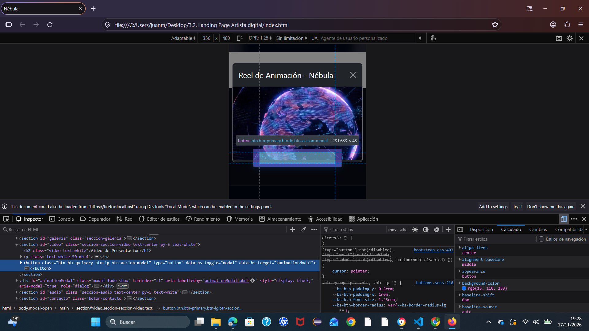
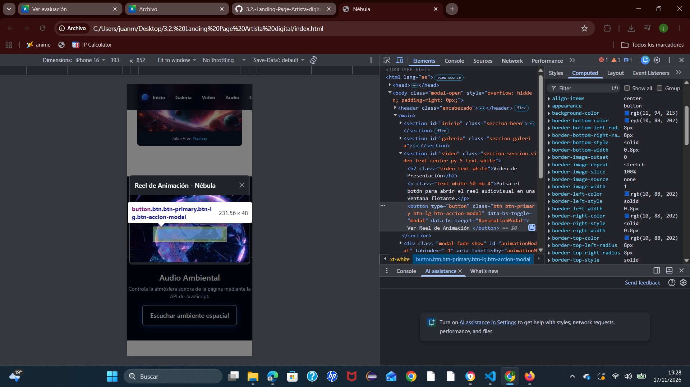
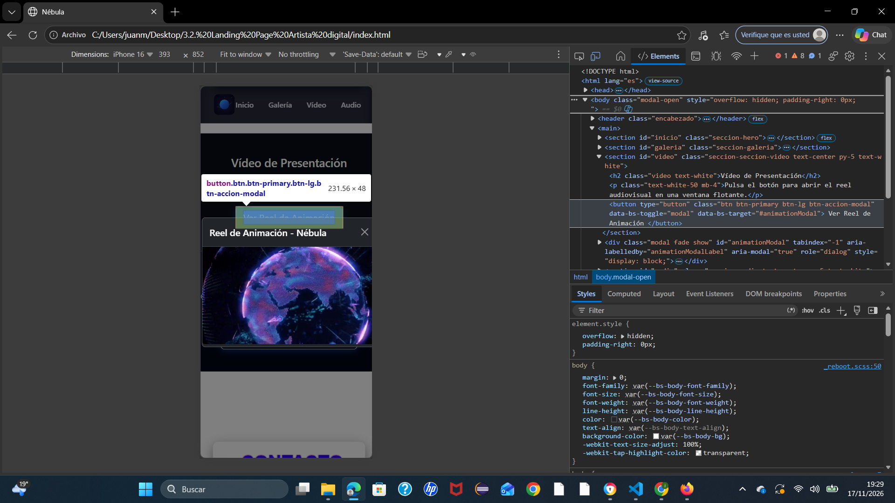

¿Qué ocurriría si un recurso fuera CC BY-SA?

**CC (Creative Common):** Esto significa que pueden compartir sus obras de forma libre y gratis pero pudiendo establecer que permisos le dan al público.

**BY:** El usuario debe reconocer la autoría de la obra indicando nombre, fuente y tipo de licencia.

**SA:** Las obras derivadas deben distribuirse bajo la misma licencia que el original, garantizando la continuidad de los permisos en la cadena de reutilización. 

Por lo tanto, que un archivo tenga la licencia CC BY-SA significa que yo puedo adquirir ese archivo de manera libre y gratuita pero con dos condiciones, la primera es que tengo que reconocer el autor de la obra con su nombre, fuente y tipo de licencia y la segunda condición es que ademas tengo prohibido cambiarle el tipo de licencia al archivo.

**VENTAJAS DE SVG INLINE**

**Manipulación total mediante CSS y JavaScript:** Al formar parte directa del DOM, podemos acceder a sus elementos para modificar propiedades visuales de estilo (como los trazos stroke o los rellenos fill), efectos de brillo (filter) o escalas de transformación.

**Rendimiento y Carga Cero (0 peticiones HTTP):** Al estar escrito directamente en el código HTML, el navegador no necesita realizar ninguna petición http para descargar un archivo externo, eliminando tiempos de espera.

**Escalabilidad Vectorial Perfecta (Resolución Independiente):** Al ser vectores, el logotipo se renderiza con nitidez en cualquier cantidad de píxeles, pantallas o dispositivos móviles de alta resolución sin pixelarse nunca.

**Optimización de Peso:** Su tamaño en bytes es mínimo en comparación con una imagen rasterizada equivalente, y es totalmente comprensible y modificable por el navegador.

## Navegadores

